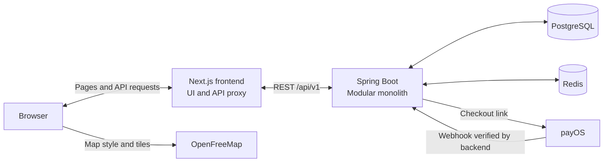

# Flight Booking System


**[Live Demo ↗](https://skywaybooking.vercel.app/)** · [Technical Highlights](#technical-highlights) · [Run Locally](#run-locally) · [Documentation](#documentation)

A full-stack flight booking application for searching flights, selecting seats, managing passengers and completing checkout through payOS. Built with a Spring Boot backend and Next.js frontend, it focuses on consistent reservations under concurrent requests and asynchronous payment confirmation.

**Try demo** uses one shared account with simulated payment and no money transfer. Ordinary registered accounts use live payOS checkout. See [Run and try the demo](docs/04-demo-experience.md) for setup and the visitor flow.

Flights marked `DEMO` are simulated inventory. Printed e-tickets are demo booking confirmations, not airline boarding passes.

## Features

- **Flight discovery:** domestic/international airport data, one-way and round-trip search, airline/fare/time filters and airport-local departure/arrival times, plus a route map that follows the selected airports.
- **Seat selection:** economy/business seat maps, auto-assignment and temporary holds after sign-in.
- **Passenger management:** adult/child/infant validation, guardian selection, saved passenger quickfill and optional baggage, meal and insurance add-ons.
- **Booking and payment:** backend-calculated totals, booking references, payOS QR/checkout links and status recovery after reload.
- **Personal bookings:** history, payment continuation, pending-booking cancellation and printable confirmed tickets.
- **Authentication:** registration, login, refresh and logout with account-bound checkout cleanup.
- **Administration APIs:** airport, airline, aircraft and flight management.

Email and in-app notifications are not implemented; confirmation is shown in the web app (payment result and My Bookings). Voucher application and refund execution remain planned workflows.

## Technical Highlights

- **Concurrency-safe allocation:** Redis leases and conditional seat updates protect competing reservations. Retries preserve hold deadlines; stale cleanup cannot release a newer hold.
- **Transaction consistency:** booking records, legs, passengers, tickets and seat claims commit together. Provider network calls run outside payment preparation/attachment transactions.
- **Idempotent payment confirmation:** verified receipts are checked against the payable amount and deadline; duplicate callbacks do not issue tickets again, and late receipts cannot reopen cancelled bookings.
- **Session lifecycle:** single-use refresh tokens and account-bound cleanup protect session recovery, logout and account switching.
- **Recovery after uncertain requests:** checkout avoids automatically resending a booking request whose previous outcome is unknown.

## Tech Stack

| Area | Technologies and purpose |
| --- | --- |
| Backend | Java 21, Spring Boot 3.5, Spring Security, Spring Data JPA and Bean Validation. |
| Frontend | Next.js 16 App Router, React 19, TypeScript and Tailwind CSS. |
| Persistence | PostgreSQL with Flyway migrations for durable business records and schema evolution. |
| Temporary state | Redis 7 for seat leases and authentication-related state. |
| Payments | payOS SDK, QR checkout and verified webhooks; marked demo accounts use simulated checkout. |
| Maps | MapLibre GL JS and OpenFreeMap. |
| Testing | JUnit, Mockito and PostgreSQL/Redis Testcontainers; Node/jsdom regressions and Playwright browser smoke. |
| Tooling | Maven Wrapper, pnpm, Docker Compose and GitHub Actions. |

## Architecture



The backend modules share one application and database. Browser API calls use a same-origin Next.js rewrite; booking, pricing and authorization decisions remain in Spring Boot. The frontend polls persisted payment status, so a browser redirect alone never confirms payment.

## Run Locally

### Prerequisites

- JDK 21.
- Node.js 24 and pnpm 12.3.4, matching frontend CI.
- Docker with Docker Compose for PostgreSQL 17 and Redis 7.
- OpenSSL for the example local JWT-key command, and your payOS development integration credentials.

### 1. Start local services

```sh
git clone https://github.com/thannthai/flight-booking-system.git
cd flight-booking-system
docker compose up -d postgres redis
```

Wait for PostgreSQL and Redis to finish starting. The backend defaults match [docker-compose.yml](docker-compose.yml): PostgreSQL database `flight_booking` on port 5432 and Redis on port 6379. Use `DB_URL`, `DB_USERNAME`, `DB_PASSWORD` and `SPRING_DATA_REDIS_*` to override them.

### 2. Start the backend

In a terminal at the repository root, replace the payOS placeholders with your development values:

```sh
cd backend
export JWT_SECRET="$(openssl rand -base64 32)"
export PAYOS_CLIENT_ID='your-development-client-id'
export PAYOS_API_KEY='your-development-api-key'
export PAYOS_CHECKSUM_KEY='your-development-checksum-key'
export PAYOS_RETURN_URL='http://localhost:3000/payment/success'
export PAYOS_CANCEL_URL='http://localhost:3000/payment/cancel'
./mvnw spring-boot:run
```

The API runs at `http://localhost:8080`; Flyway applies migrations at startup. Spring Boot reads exported variables and does not automatically load `backend/.env`. Keep credentials out of Git. Payment confirmation requires a configured, publicly reachable webhook.

### 3. Start the frontend

In another terminal at the repository root:

```sh
npm install --global pnpm@12.3.4
cd frontend
pnpm install --frozen-lockfile
test -f .env.local || cp environment.example .env.local
pnpm dev
```

Open **http://localhost:3000**. API requests are forwarded to the local backend.

A fresh database includes airports but no flight schedules. Add inventory through
admin APIs or configure the [optional demo generator](docs/02-system-architecture.md#54-events-listeners-and-jobs) before searching.

## Deployment configuration

Use HTTPS and set the frontend's server-only
`BACKEND_API_URL=https://<backend-host>/api/v1` before building.
See [deployment settings](docs/02-system-architecture.md#55-deployment-configuration-boundary)
for backend profiles, required environment variables and cookie configuration.

## API Documentation

After starting the backend:

- [Swagger UI](http://localhost:8080/swagger-ui.html)
- [OpenAPI JSON](http://localhost:8080/v3/api-docs)

These are local development endpoints. Protected APIs require a Bearer access token; administrative APIs require `ROLE_ADMIN`.

## Testing

From `backend/`, with Docker available for integration tests:

```sh
./mvnw clean verify
```

From `frontend/`:

```sh
pnpm test
```

See [verification commands](AGENTS.md#commands-and-verification) for type checking,
lint, dependency audit, production build and Playwright. Integration tests use
isolated services; browser tests mock APIs.

## Documentation

- [Project Specification](docs/01-project-specification.md) — features, scope and key business rules.
- [System Architecture](docs/02-system-architecture.md) — module boundaries, integrations and design decisions.
- [Database Design](docs/03-database-design.md) — tables, relationships and integrity protections.
- [Run and Try the Demo](docs/04-demo-experience.md) — backend setup and the shared-account visitor flow.
- [Critical Flows](docs/05-critical-flows.md) — seat hold and booking, payment webhook, and booking expiry sequences.
- [Architecture Decisions](docs/adr/README.md) — short records of the main design choices and their trade-offs.
