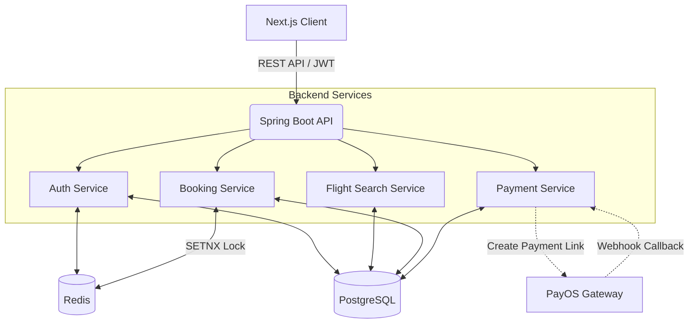

<div align="center">
  <h1>✈️ Skyway - Modern Flight Booking Platform</h1>
  <p><strong>A full-stack flight booking portfolio project</strong></p>

  [](https://nextjs.org/)
  [](https://spring.io/)
  [](https://postgresql.org/)
  [](https://redis.io/)
  [](#)
</div>

---

## 🌐 Live Demo
Deployment URLs and hosting integration have not been verified in this repository checkpoint.
Local Swagger UI is available at `http://localhost:8080/swagger-ui.html` after backend setup.

---

## 📖 Project Overview
Skyway is a full-stack flight booking system built to handle real-world aviation business logic. It provides a seamless user experience for searching flights, selecting seats, managing passenger details, and processing secure payments. The architecture is designed to handle high concurrency and ensure data consistency during the checkout phase.

---

## 🚀 Key Features
* **Dynamic Flight Search:** Multi-criteria search for both One-Way and Round-Trip flights.
* **Interactive Seat Mapping:** Visual cabin layout allowing precise seat selection.
* **Smart Passenger Directory:** Auto-saves and autofills returning passenger information.
* **Demo E-Tickets:** Displays backend-issued tickets after payment confirmation; these are not airline boarding passes.
* **My Bookings Dashboard:** Users can manage and view their flight itineraries.

---

## 🧠 Technical Highlights & Best Practices

To ensure system reliability resembling real-world OTAs (like Traveloka or Agoda), this project implements several advanced technical patterns:

### 1. Distributed Seat Locking (Concurrency Control)
When thousands of users hunt for cheap tickets simultaneously, multiple users might select the same seat.
* **The Solution:** We utilize **Redis `SETNX`** (Set if Not eXists) as a distributed lock.
* **Mechanism:** The backend coordinates Redis leases with persisted seat ownership, expiry and database locks. Lease generation checks prevent cleanup from releasing a newer hold. Redis expiry alone does not establish seat availability; booking/payment transitions and cleanup reconcile database state. Hold TTL is configurable; payment uses the booking's backend deadline.

### 2. Secure Webhook Processing (Payment Integrity)
Payments are processed via **PayOS (VietQR)**. The webhook listener is hardened against multiple attack vectors:
* **Idempotency:** Verified webhook events are reconciled against persisted payment state. Valid duplicate notifications do not issue tickets again, and late payments cannot reopen a terminal booking.
* **Amount Verification:** The system strictly verifies that the amount reported by the webhook matches the locked `totalAmount` in the database (`data.getAmount() == lockedPayment.getAmount()`). This prevents attackers from manually calling the webhook with a manipulated amount (e.g., paying 10,000 VND for a 5,000,000 VND ticket).
* **Atomicity:** Updating the Payment, Booking, and issuing Tickets are wrapped in a single Database Transaction.

---

## 🏗 System Architecture



---

## 📂 Directory Structure

```text
flight-booking-system/
├── backend/                       # Spring Boot Application
│   ├── src/main/java/.../backend/
│   │   ├── auth/                  # JWT, Security Filters, Users
│   │   ├── booking/               # Core booking logic, Seat hold, Tickets
│   │   ├── flight/                # Flight search, Airlines, Airports
│   │   ├── payment/               # PayOS integration, Webhooks
│   │   └── common/                # Exceptions, Configs, Responses
│   └── src/main/resources/
│       └── db/migration/          # Flyway SQL migrations
│
├── frontend/                      # Next.js Application
│   ├── app/                       # App Router (Pages & Layouts)
│   ├── components/                # Reusable UI components (Booking, Seats, etc.)
│   ├── lib/                       # API clients, Context, Utils
│   └── types/                     # TypeScript interfaces
│
└── docs/                          # System documentation & API Plans
```

---

## 🛠 Local Development Setup

*While the live demo is available, you can also run this project locally to inspect the codebase.*

### Prerequisites
* Java JDK 21; use the Maven wrapper in `backend/`
* Node.js 24 & pnpm 12.3.4, matching frontend CI
* PostgreSQL (Running on port 5432)
* Redis (Running on port 6379)

### 1. Run the Backend
```bash
cd backend
# Export the required environment variables from application.yaml using local/test values.
# Spring Boot does not automatically load backend/.env.
# The application automatically runs Flyway migrations to setup the DB schema
./mvnw spring-boot:run
```
*API will run on `http://localhost:8080`*

### 2. Run the Frontend
```bash
cd frontend
npx --yes pnpm@12.3.4 install --frozen-lockfile

# Copy the template if .env.local does not already exist; preserve existing local configuration.
test -f .env.local || cp environment.example .env.local
# Browser calls /api/v1; Next proxies to server-only BACKEND_API_URL.

npx --yes pnpm@12.3.4 run dev
```
*Client will run on `http://localhost:3000`*

---
<div align="center">
  <i>Developed with ❤️ by Thai Chi Thanh</i>
</div>
## Persistent demo flights

Flights with `source=DEMO` are simulated schedules and prices, not official airline inventory.
The optional Java generator stores a rolling 30-local-day window in PostgreSQL. It runs at
startup and every hour; expired slots (including a two-hour departure buffer) are skipped.
It never updates/deletes existing flights, seats, bookings, tickets or payments.

The default YAML roster covers VN/VJ/QH, with one domestic/international return pair per
configured airline per day, alternating by calendar date. Existing airlines must already
exist; the generator never creates or updates airline master records. Flight and seat counts
depend on the configured roster, capacity and available aircraft. A missing or
unsuitable aircraft can use an insert-only `DEMO-<CODE>-R<outbound-slot>` fallback (180 seats). Missing
airports/airlines or runtime errors are logged and isolated. A database outage stops that
reconciliation attempt, not the backend. Flyway/database startup failures still follow
Spring Boot's normal startup behavior.

Enable only against a dedicated local/dev or demo database:

```text
SPRING_PROFILES_ACTIVE=demo
DEMO_FLIGHTS_ENABLED=true
DEMO_FLIGHTS_ALLOWED_JDBC_URL=<exact same JDBC URL as DB_URL>
DEMO_FLIGHTS_WINDOW_DAYS=30
DEMO_FLIGHTS_INTERVAL_MS=3600000
DEMO_FLIGHTS_MAX_FLIGHTS_PER_DAY=12
DEMO_FLIGHTS_MAX_WINDOW_SEATS=90000
```

Disabled is the default. `demo`/`dev` profile and exact datasource URL opt-in are required;
`prod`/`production` profiles are rejected before generator writes. URL matching is an
accidental-configuration guard, not a substitute for separate database credentials.
Never put credentials into committed configuration or logs. Test locally before enabling
these variables on Render; this feature does not require direct SQL seeding every day.

`backend/src/main/resources/demo-flight-templates.yaml` defines airline rosters, stable
base36 two-character direction slots, effective dates, routes, duration, turnaround,
prices and candidate registrations. Append a schedule version with an effective date
after the last generated date when changing rosters; retain prior versions. An airline
without a configured entry is not assigned inferred routes. Round-robin admission respects
the configured daily capacity; missing roster members
leave empty slots. Configured roster size must permit both route categories within 30 days.
Only new occurrences use new configuration. Slot identities must not be reassigned.

V9 adds the DEMO source constraint and a partial unique flight-number index. Flight and
all seats commit atomically. A transaction-scoped PostgreSQL advisory lock serializes
budget check/insert across generator instances; unique constraints enforce idempotency.
No Redis holds are read or changed. This lock does not coordinate manual admin aircraft
scheduling; suitability checks inspect known overlapping flights, not a global aircraft
reservation system. Existing occurrence conflicts are skipped rather than repaired.

Public search excludes departed flights; admin/history search retains historical access.
Frontend results identify DEMO flights as simulated inventory.

No old flights are cleaned up in v1. The 90,000-seat cap applies only to the current demo
window, not all historical data. Monitor retained database growth and reconciliation logs
(`created`, `skipped`, `failed`, dates and per-occurrence failure reason). Retention requires
a separate decision. Render sleep is recovered by startup reconciliation; a paused Supabase
project must be resumed independently. This feature cannot guarantee free-tier uptime.


The active FlightSource values are MANUAL and DEMO. V10 removes unused CRAWLER support
without modifying prior migration checksums. If historical CRAWLER rows exist, the
migration refuses to relabel them automatically; classify those records explicitly
before deploying this change. Pushing Git does not copy local database rows to Supabase.
Flyway and the enabled generator execute when the backend starts against its configured
datasource. The demo YAML contains recurring templates, not persisted flights.
