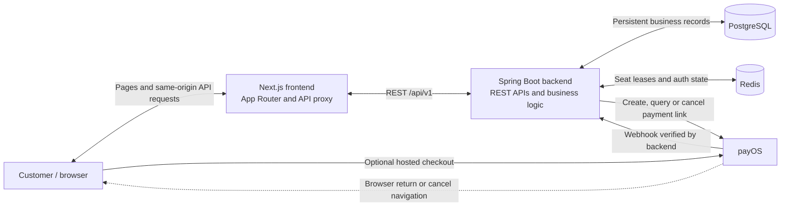
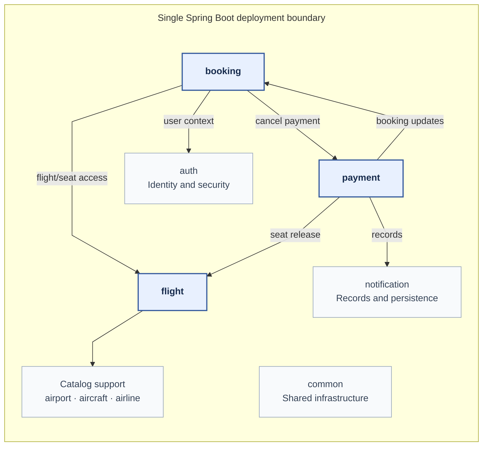
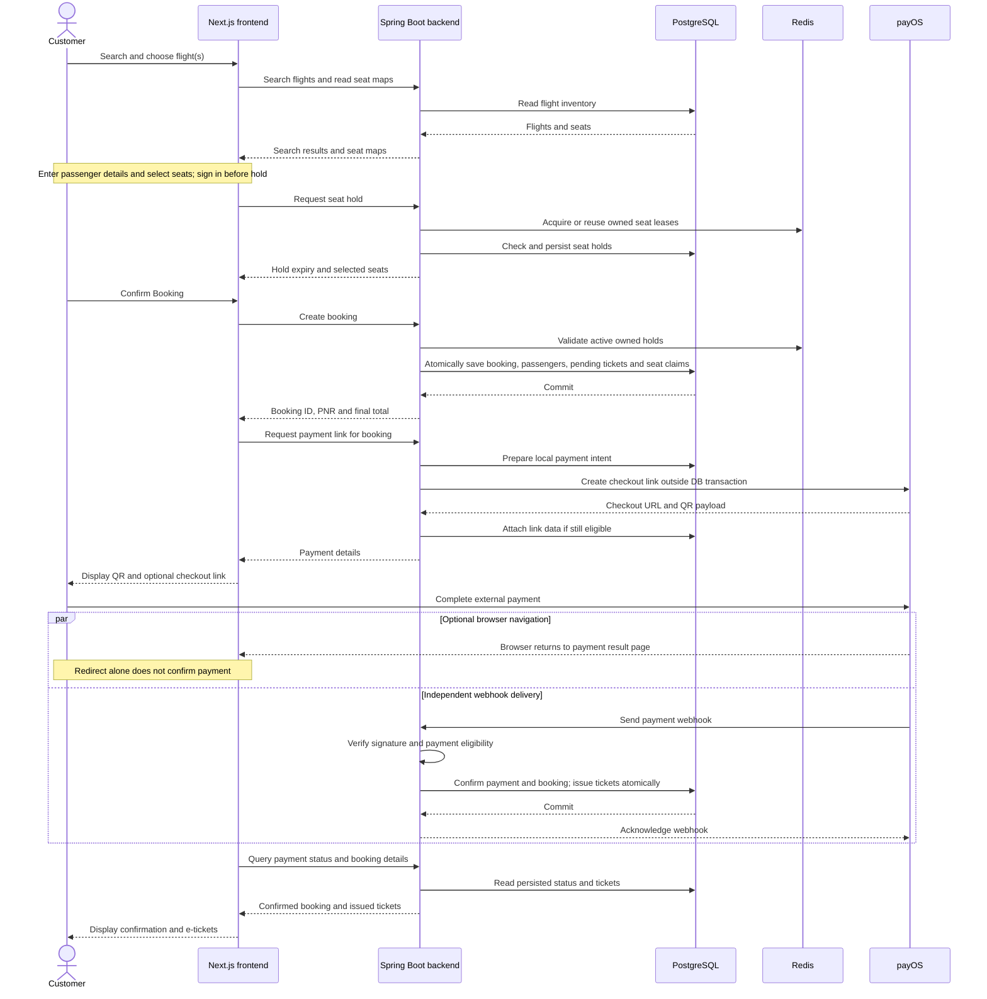

# Flight Booking System — System Architecture

The system uses a Spring Boot modular monolith behind a Next.js frontend. This document explains component responsibilities, integration and the main design trade-offs; [Project Specification](01-project-specification.md) describes functionality.

## 1. Architecture overview

Flight Booking System uses a **Spring Boot modular monolith** behind a Next.js customer frontend. Backend packages organize authentication, catalog, flight inventory, booking and payment responsibilities. They run within one Spring application and share a PostgreSQL database and transaction manager.

These are logical modules, not independently deployed services. Calls between them are Java method calls and repository access, rather than internal HTTP requests or messages between microservices. Next.js and Spring Boot are separate application boundaries; payOS is an external system.

The main architectural goals are:

- Keep inventory, reservation, payment and authorization decisions authoritative in the backend.
- Coordinate concurrent seat allocation without partially saved reservations.
- Separate external payment activity from local database transactions.
- Make reloads and asynchronous confirmation recoverable through persisted state.
- Keep the system understandable and testable at portfolio scale.

A single backend application makes related booking/payment updates easier to coordinate and avoids distributed service transactions. The trade-off is shared release/runtime boundaries and substantial coupling between core modules. Package organization is not enforced isolation: there is no Spring Modulith or separate Maven-module boundary in the current build.

## 2. Overall system architecture

The frontend node represents the Next.js application, including client components executed in the browser and server-side API forwarding. The API proxy is a Next.js rewrite, not a second booking service or an API gateway with its own business rules.

Most interactions are synchronous request/response operations: flight search, holding seats, booking creation and payment-link initialization. Webhook delivery is asynchronous relative to customer checkout, although each webhook is an HTTP request handled by the backend. Background jobs and asynchronous listeners also execute within the Spring application.

The browser does not access PostgreSQL or Redis. It can open payOS checkout, but the backend controls the payable amount and interprets the verified payment notification.

## 3. Backend module architecture

### 3.1 Responsibilities

| Module | Responsibility |
| --- | --- |
| `auth` | Accounts, credentials, JWT validation, refresh/revocation state, authenticated principals and Spring Security configuration. |
| `airport` | Airport metadata, including timezones; catalog lookup and administrative maintenance. |
| `airline` | Airline metadata and administrative maintenance. |
| `aircraft` | Aircraft ownership, registrations and cabin capacity configuration. |
| `flight` | Flight search/details, seat maps and initial seat inventory, flight administration and optional demo generation. |
| `booking` | Seat holds, passenger directory, booking/leg/passenger/ticket records, pricing and pending-booking cancellation. Tickets belong here; there is no separate ticket service. |
| `payment` | Payment intents, payOS adapter/configuration, verified webhook processing, cancellation coordination, payment-success events/listener and unpaid-booking timeout cleanup. |
| `notification` | Notification entities, status/type definitions and persistence. It does not implement an email-delivery service. |
| `common` | API/page envelopes, error handling, shared entity metadata, JPA timestamp auditing and cookie utilities. It does not own booking or payment policy. |

### 3.2 Important dependencies

Booking, Payment and Flight form the core; the other modules provide identity, notification, catalog or shared support. Arrows show selected source-level dependencies, not HTTP calls or execution order. The arrow to **Catalog support** summarizes Flight's access to `airport`, `aircraft` and `airline`. This is a visual group, not a new module or deployment boundary. Repeated shared-infrastructure dependencies are omitted.

The most important coupling is **Booking ↔ Payment**. Booking cancellation accesses payment persistence and the gateway; payment confirmation/cancellation accesses booking, ticket and seat persistence directly. This is source-level coupling, not necessarily a circular Spring bean dependency. The payment-success listener is located in `payment/event` and writes through the notification repository; the notification package is not a subscriber service on a message bus.

Flight services access catalog repositories directly. Catalog deletion checks also consult flight references. These shared repositories/entities make consistency practical in a monolith, but extracting a module would require replacing these dependencies and reconsidering transaction ownership.

### 3.3 Request handling pattern

Controllers handle HTTP mapping, request validation, authenticated principals and response DTOs. Services coordinate business validation, ownership and state changes. Repositories read/write records through Spring Data JPA, with selected explicit SQL/JDBC operations where database behavior matters. Mappers separate persistence entities from API responses.

Security filters authenticate protected requests before controller handling; services still enforce resource ownership. Module boundaries are maintained through package conventions and shared code rather than strict domain isolation.

**Sources:** [backend packages](../backend/src/main/java/com/thanh/backend/), [BookingService](../backend/src/main/java/com/thanh/backend/booking/service/BookingService.java), [PaymentServiceImpl](../backend/src/main/java/com/thanh/backend/payment/service/impl/PaymentServiceImpl.java), [FlightService](../backend/src/main/java/com/thanh/backend/flight/service/FlightService.java).

## 4. Data storage and consistency

### 4.1 PostgreSQL and schema ownership

PostgreSQL holds persistent business state: users, catalog/inventory, bookings and legs, passengers/documents, tickets/add-ons, payments and notification records. Booking/payment status returned to customers comes from these records, not browser state or provider redirect parameters.

Flyway owns versioned schema changes. The complete migration sequence matters: later migrations refine payment states, uniqueness and flight provenance. Hibernate validates entity/schema compatibility rather than generating the schema. Foreign keys and selected unique constraints complement service validation; they do not replace every business check.

All modules share a database and persistence model. Booking creation can therefore save its related records and seat claims in one local database transaction. Eligible payment confirmation likewise updates payment, booking and tickets together. There is no separate payment database or event-sourced projection.

### 4.2 Redis has distinct operational roles

| Redis state | Role | Relationship to PostgreSQL |
| --- | --- | --- |
| Seat leases | Temporary, expiring ownership of a selected seat. | Reservation creation also validates persisted ownership, expiry and seat state. Redis alone cannot establish a booked seat. |
| Refresh-token registrations | Track valid refresh credentials and their revocation/rotation. | User identity and roles remain persisted in PostgreSQL. |
| Access-token blacklist | Revoke supplied access tokens before their natural expiry. | Protected-request authentication checks revocation in addition to JWT validity and user lookup. |

Redis is not merely an optional read cache. It participates in admission to booking and authentication; outages can prevent those operations even when PostgreSQL is available.

### 4.3 Transaction boundaries

PostgreSQL and Redis do not share a distributed transaction. The application coordinates leases with persisted seat state, transaction completion and ownership-aware cleanup. Database booking creation is atomic, but the two stores are not claimed to change atomically together. Temporary stale leases/held records are possible; they do not independently authorize a second booking.

Payment-link creation separates a committed local intent, the external payOS call and subsequent URL/QR attachment. This avoids holding database locks across provider network latency, at the cost of intermediate states requiring reconciliation. A failed or timed-out HTTP response does not establish whether a mutation committed.

Concurrency and recovery behavior are exercised by the [backend integration tests](../backend/src/test/java/com/thanh/backend/booking/service/).

**Sources:** [migrations](../backend/src/main/resources/db/migration/), [application configuration](../backend/src/main/resources/application.yaml), [lease coordination](../backend/src/main/java/com/thanh/backend/booking/service/SeatHoldTransactionLifecycle.java), [JWT state management](../backend/src/main/java/com/thanh/backend/auth/service/JwtService.java).

## 5. Communication and integration

### 5.1 Frontend and API proxy

The App Router supplies the main booking page and `/payment/[result]`. The main page composes client-side search, passenger entry, seat selection and payment steps; they are not separate backend services or individual App Router pages. Domain components own their forms/interactions, while shared checkout models/builders map data to API DTOs.

The browser API facade delegates HTTP transport, session coordination and typed domain methods to separate helpers. Browser requests target same-origin `/api/v1`; the rewrite forwards them to server-only `BACKEND_API_URL`. The proxy does not calculate authoritative fares, decide ownership or confirm payment.

This arrangement keeps refresh-cookie requests first-party to the browser. The backend still has explicit CORS/security rules; actual cookie forwarding and secure-cookie behavior depend on hosting configuration and require integration verification.

### 5.2 Authentication and session coordination

Register/login return an access token and user while setting the refresh token through `Set-Cookie`. The frontend keeps the access token in memory and sends it as Bearer authorization; refresh uses the HttpOnly cookie. The backend validates JWT type/expiry/revocation and loads the current user/authorities for protected requests.

The session coordinator shares refresh requests and discards responses from obsolete sessions. Logout/account changes clear private drafts. Reload recovery uses tab-local storage; uncertain booking outcomes require reconciliation through history rather than automatic resubmission.

**Sources:** [Next rewrite](../frontend/next.config.mjs), [API facade](../frontend/lib/api.ts), [session coordination](../frontend/lib/auth-session.ts), [security configuration](../backend/src/main/java/com/thanh/backend/auth/security/SecurityConfig.java), [cookie handling](../backend/src/main/java/com/thanh/backend/common/utils/CookieUtils.java).

### 5.3 payOS and payment observation

The payment module calls payOS through a gateway interface backed by the provider SDK. It creates/reuses checkout links, can query a link during initialization reconciliation, submits asynchronous link cancellation and verifies webhook signatures.

The backend receives a webhook and verifies it **before** applying payment rules. Eligible receipts update persisted payment/booking/ticket state; duplicate or terminal receipts follow the existing consistency protections. A browser redirect has no authority to perform these transitions.

The frontend renders the returned QR payload locally and periodically reads payment status plus booking details. Those status reads query application persistence, not payOS on every poll. There is no implemented WebSocket/SSE payment push channel. Return/cancel pages resume this same authenticated status-reading flow.

### 5.4 Events, listeners and jobs

| Mechanism | Implemented interaction |
| --- | --- |
| Payment success event | Published in-process after the payment transaction commits. An asynchronous listener in `payment` reads booking data and stores a notification record. It does not send email. |
| Provider link cancellation | Submitted through an asynchronous gateway method; it does not itself refund money. |
| Unpaid-booking cleanup | A scheduled job in `payment` processes overdue pending bookings, updates local state/releases seats, then requests provider cancellation when applicable. |
| Optional demo generation | A startup/scheduled process in `flight` generates simulated inventory through a transactional writer, subject to environment/target checks and inventory budgets. |
| Lease cleanup | Internal deferred cleanup work in `booking`; it is not a notification/event-delivery queue. |

These events and jobs run inside Spring Boot. In-process asynchronous execution is not a durable message queue; follow-up delivery is best-effort and separate from the committed booking/payment outcome.

**Sources:** [gateway adapter](../backend/src/main/java/com/thanh/backend/payment/service/impl/PayOSGatewayServiceImpl.java), [success listener](../backend/src/main/java/com/thanh/backend/payment/event/PaymentSuccessEventListener.java), [timeout job](../backend/src/main/java/com/thanh/backend/payment/scheduler/BookingPaymentCleanupScheduler.java), [demo generator](../backend/src/main/java/com/thanh/backend/flight/demo/DemoFlightGenerator.java).

## 6. High-level booking workflow

The sequence shows a successful new booking. The frontend participant groups browser UI and the Next.js rewrite for readability; every frontend-to-backend API request uses that proxy. Payment setup may reuse existing state, and polling can occur before or during webhook processing.

The critical handoff is from a pending reservation to backend-confirmed issuance. The initial booking already owns its allocated seats but does not yet have issued tickets. A valid webhook changes that state; polling exposes the committed result to the customer. Cancellation/expiry and refund-review branches are defined in the specification rather than expanded into this success-path diagram.

**Sources:** [booking orchestration](../backend/src/main/java/com/thanh/backend/booking/service/BookingService.java), [payment orchestration](../backend/src/main/java/com/thanh/backend/payment/service/impl/PaymentServiceImpl.java), [frontend checkout composition](../frontend/app/page.tsx), [frontend payment recovery](../frontend/lib/payment.ts).

## 7. Architecture decisions and trade-offs

These decisions describe the current implementation and its rationale; they are not claims that historical ADRs exist.

| Decision | Benefit for this project | Cost or boundary |
| --- | --- | --- |
| Modular monolith | One backend codebase and local transactions keep reservation consistency manageable. | Shared persistence and direct cross-module access limit isolation and independent releases. |
| PostgreSQL plus Redis | Durable relational state combines with expiring holds and revocable sessions. | Coordinating two stores requires explicit failure handling; Redis is an operational dependency. |
| Backend-authoritative workflow | Ownership, price and payment results do not depend on browser trust. | Frontend must refresh authoritative state and handle stale drafts/unknown outcomes. |
| Webhook confirmation | Payment settlement is observed independently of whether the browser returns. | Confirmation depends on provider delivery/verification; the customer may wait while polling. |
| Separate payment intent and provider call | Slow external HTTP does not hold the preparation transaction open. | Partial initialization is a valid intermediate condition requiring reuse/reconciliation. |
| Same-origin frontend proxy | A consistent browser API path supports cookie-based refresh. | Adds a forwarding boundary whose configuration and cookie behavior need integration testing. |
| In-process asynchronous work | Simple follow-up processing without operating a message broker. | No durable delivery, replay or retry guarantee for notifications/provider follow-up. |

The [backend tests](../backend/src/test/java/com/thanh/backend/) exercise selected consistency scenarios. Existing [browser smoke](../frontend/e2e/booking.spec.ts) mocks APIs; deployed proxy/cookie behavior and real payOS integration require separate verification.
