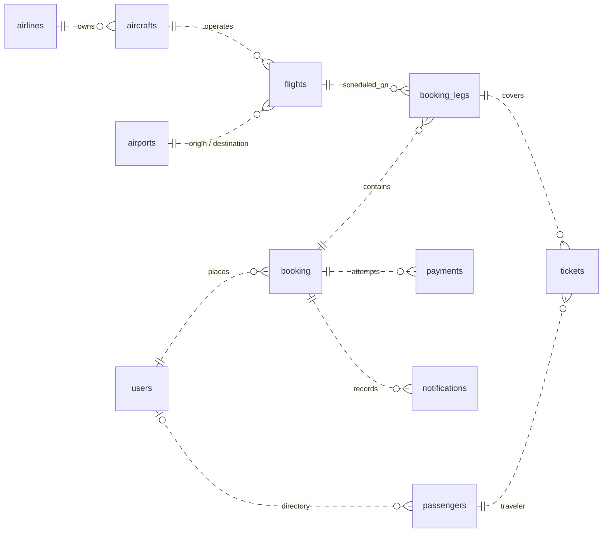
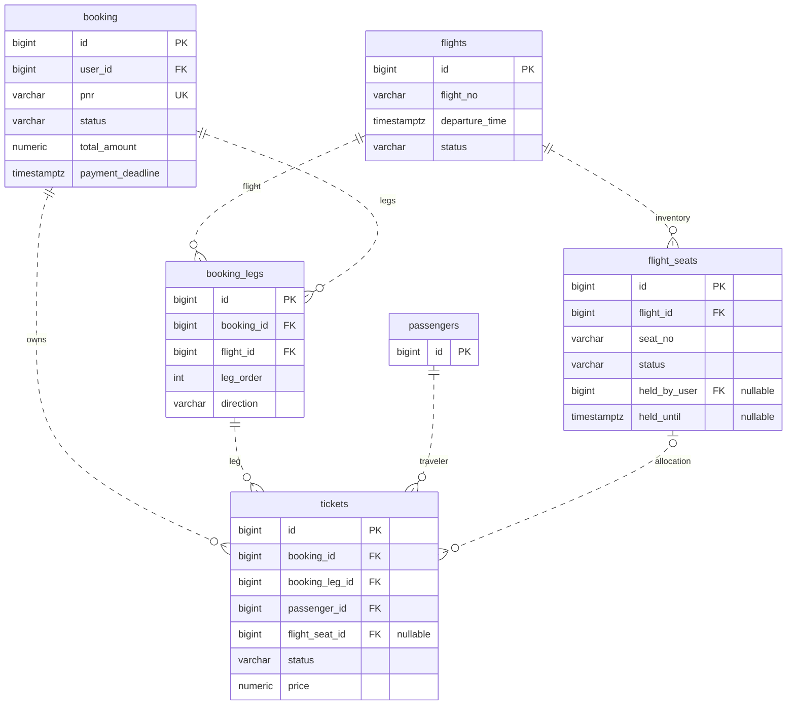
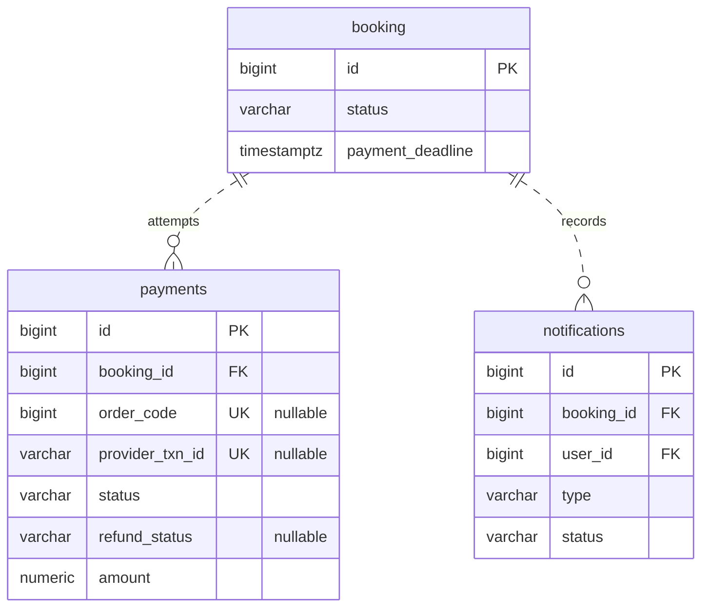

# Flight Booking System — Database Design

## 1. Overview

PostgreSQL stores accounts, flight inventory, reservations, tickets, payments and notification records. The backend shares one relational database, allowing related booking/payment changes to use local transactions. Flyway V1–V12 define the physical schema; JPA/Hibernate maps and validates application entities.

Redis separately manages temporary seat leases and authentication state. PostgreSQL remains authoritative for persisted business outcomes.

## 2. Tables and relationships

### 2.1 Table overview

The schema contains **16 application tables**. Each uses a numeric `id` primary key and creation/update timestamps.

| Group | Table | Purpose |
| --- | --- | --- |
| Authentication | `users` | Accounts and password hashes. |
| Catalog | `airports` | Airport location and timezone metadata. |
| Catalog | `airlines` | Airline identity and baggage metadata. |
| Catalog | `aircrafts` | Registrations and cabin capacities. |
| Inventory | `flights` | Scheduled flight occurrences, routes and base prices. |
| Inventory | `flight_seats` | Per-flight seats, prices, availability and hold ownership. |
| Booking | `booking` | Reservation owner, contact details, amounts and deadline. |
| Booking | `booking_legs` | Ordered flights in a reservation. |
| Passengers | `passengers` | Traveler identity, directory membership and guardian links. |
| Passengers | `passenger_documents` | Traveler identity documents. |
| Tickets | `tickets` | Passenger entitlement for a booking leg and optional seat. |
| Tickets | `add_on_services` | Purchased add-on descriptions, prices and quantities. |
| Payment | `payments` | Payment intents, provider references and receipt/refund-review state. |
| Notifications | `notifications` | Confirmation recipients and recorded outcomes. |
| Schema support | `vouchers` | Discount definitions; no implemented voucher workflow. |
| Schema support | `audit_logs` | Administrative action records; no implemented audit-log workflow. |

Flyway's `flyway_schema_history` is metadata outside this application-table count. The payment order-code sequence is also separate.

### 2.2 Main relationships

A booking contains ordered legs, each referencing a flight. A ticket links a passenger to a booking leg and, for seated passengers, a flight seat. Infants have tickets without seats. Cancelled tickets may retain historical seat references while the seat is later allocated to another reservation.

`users.demo_alias` is a nullable, unique marker identifying demo accounts.

Passengers may belong to a personal directory and reference a guardian. Removing a ticket-linked passenger from the directory detaches ownership while preserving ticket references. A booking may have multiple historical payment records.

Booking totals/contact details, ticket fares and purchased add-on descriptions/prices are stored at creation. Flight, seat and passenger references remain live; this is not a fully immutable snapshot model.

## 3. Entity relationship diagrams

The diagrams show selected physical foreign keys. `||` means one parent, `|o` an optional parent and `o{` zero or many children. Dashed lines represent non-identifying relationships.

### 3.1 Relationship overview

The airport link summarizes the separate origin and destination FKs.

### 3.2 Booking and seat inventory

Selected columns show keys, allocation state and hold ownership. `nullable` marks optional values; some FKs reference tables outside this focused view. `UK` marks an unconditional single-column unique constraint.

### 3.3 Payment and notifications

Payments and notifications each belong to a booking.

Payments support the `DEMO` provider alongside existing provider values.

Transfer fields are nullable for compatibility with historical rows: `bank_bin`, `account_number`, `account_name`, `transfer_description`, and `transfer_amount`.

## 4. Key data integrity rules

- **Valid references:** foreign keys link reservations, legs, passengers, tickets, inventory and payments; CHECK constraints restrict supported categorical values.
- **Unique identities:** booking PNR and payment order/transaction references have uniqueness protection. Seat labels are unique within a flight, and flight number/departure pairs identify distinct occurrences.
- **One pending payment:** a partial unique index permits at most one `PENDING` payment per booking while retaining historical attempts.
- **Complete reservations:** transactions save or roll back the related booking graph and seat claims together.
- **Safe allocation:** conditional seat updates, ownership/expiry checks and Redis lease validation work together.

Indexes support route/date search, seat-status lookup, personal history and overdue-booking selection. Exact constraints and index definitions are in the [Flyway migrations](../backend/src/main/resources/db/migration/). Future schema changes should use a new migration rather than editing applied scripts.

See [System Architecture](02-system-architecture.md) for PostgreSQL–Redis coordination and the [backend integration tests](../backend/src/test/java/com/thanh/backend/) for selected integrity scenarios.
