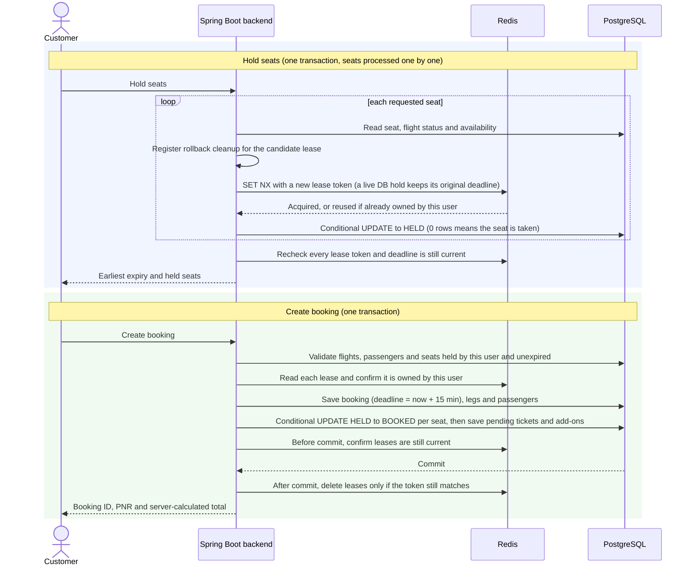
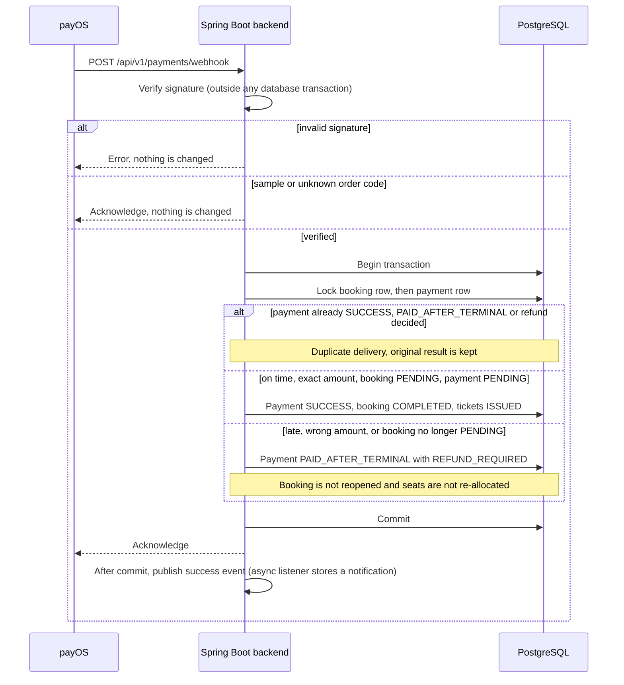
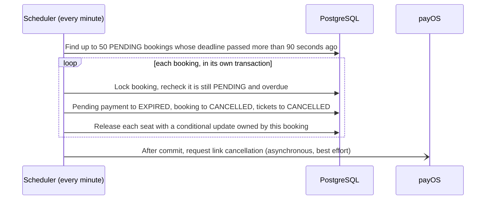

# Flight Booking System — Critical Flows

This document expands the three flows where consistency matters most. [System Architecture](02-system-architecture.md) shows the overall booking sequence; the reasoning behind each design choice is recorded in the [architecture decisions](adr/README.md).

Backend state is authoritative in every flow: a browser timer, redirect or retry cannot extend a hold, confirm a payment or reopen a terminal booking.

## 1. Seat hold and booking creation

A customer first **holds** seats, then **creates the booking** that claims them. Each step is one database transaction that also coordinates a Redis lease.

Rules the flow keeps:

- **No double allocation.** The database `UPDATE` is the decision: it succeeds only for an available seat, an expired hold, or the same user's identical live hold. Redis admission and the lease recheck add fencing but never override the row.
- **No deadline extension.** Re-holding a seat that is still live in the database reuses its original expiry (`SET ... PXAT`). A retry cannot restart the 15-minute window.
- **Older work cannot release a newer lease.** Leases carry a random token. Release is a compare-and-delete, and rollback cleanup only deletes a lease whose token matches and whose seat has no live hold in the database.
- **Atomic booking.** Booking, legs, passengers, tickets, add-ons and seat claims commit together or not at all. Prices come from server-side seat and add-on prices, never from the request.
- **Two stores, no distributed transaction.** If the process fails between the database commit and the Redis delete, the lease simply expires; the seat is already `BOOKED` in the database.

**Sources:** [BookingService](../backend/src/main/java/com/thanh/backend/booking/service/BookingService.java), [SeatHoldLeaseStore](../backend/src/main/java/com/thanh/backend/booking/infrastructure/redis/SeatHoldLeaseStore.java), [SeatHoldTransactionLifecycle](../backend/src/main/java/com/thanh/backend/booking/service/SeatHoldTransactionLifecycle.java), [FlightSeatRepository](../backend/src/main/java/com/thanh/backend/flight/repository/FlightSeatRepository.java). **Tests:** [`RedisLeaseConcurrencyIT`](../backend/src/test/java/com/thanh/backend/booking/service/RedisLeaseConcurrencyIT.java), [`SeatTransitionConcurrencyIT`](../backend/src/test/java/com/thanh/backend/booking/service/SeatTransitionConcurrencyIT.java), [`BookingConcurrencyIT`](../backend/src/test/java/com/thanh/backend/booking/service/BookingConcurrencyIT.java), [`BookingRedisConsistencyIT`](../backend/src/test/java/com/thanh/backend/booking/service/BookingRedisConsistencyIT.java).

## 2. Payment webhook

The webhook is the only way a payOS payment becomes successful. The endpoint is public, so the signature is checked before anything else.

| Situation when the verified webhook arrives | Result |
| --- | --- |
| First delivery, paid on time for the exact amount | Payment `SUCCESS`, booking `COMPLETED`, tickets `ISSUED` |
| Repeated delivery | Ignored; original reference, paid time and refund state are preserved |
| Payment time after the booking's payment deadline | Payment `PAID_AFTER_TERMINAL`, refund `REFUND_REQUIRED`; booking unchanged |
| Booking already cancelled or expired | Same as late payment; seats stay released or re-booked by others |
| Amount differs from the payment's amount | Payment `PAID_AFTER_TERMINAL`, refund `REFUND_REQUIRED`; booking stays `PENDING` |
| Unknown order code | Acknowledged and ignored |
| Provider is not payOS (for example a demo payment) | Rejected |

`REFUND_REQUIRED` records that money needs to be returned; the application does not refund automatically, so this state needs an operational process.

Payment-link creation follows the same discipline: a short transaction prepares the payment intent, the payOS call happens with no database lock held, and a second short transaction attaches the URL and QR data only if the payment is still pending. Whenever both rows are locked, the booking row is locked before the payment row.

**Sources:** [PaymentWebhookController](../backend/src/main/java/com/thanh/backend/payment/controller/PaymentWebhookController.java), [PaymentServiceImpl](../backend/src/main/java/com/thanh/backend/payment/service/impl/PaymentServiceImpl.java), [PayOSGatewayServiceImpl](../backend/src/main/java/com/thanh/backend/payment/service/impl/PayOSGatewayServiceImpl.java). **Tests:** [`WebhookIdempotencyIT`](../backend/src/test/java/com/thanh/backend/payment/service/WebhookIdempotencyIT.java), [`CancelPaymentLifecycleIT`](../backend/src/test/java/com/thanh/backend/payment/service/CancelPaymentLifecycleIT.java).

## 3. Unpaid booking expiry

- The deadline is set once at booking creation and copied to the payment's expiry; nothing on the client can move it.
- The 90-second grace period lets a webhook for a payment made just before the deadline arrive and complete the booking before cleanup runs. Because the webhook locks the booking first, only one of the two wins.
- Seats are released by the same conditional update used for user cancellation, so a seat that another active booking owns is never freed.

**Sources:** [BookingPaymentCleanupScheduler](../backend/src/main/java/com/thanh/backend/payment/scheduler/BookingPaymentCleanupScheduler.java). **Tests:** [`BookingExpirySeatReleaseIT`](../backend/src/test/java/com/thanh/backend/payment/scheduler/BookingExpirySeatReleaseIT.java).
